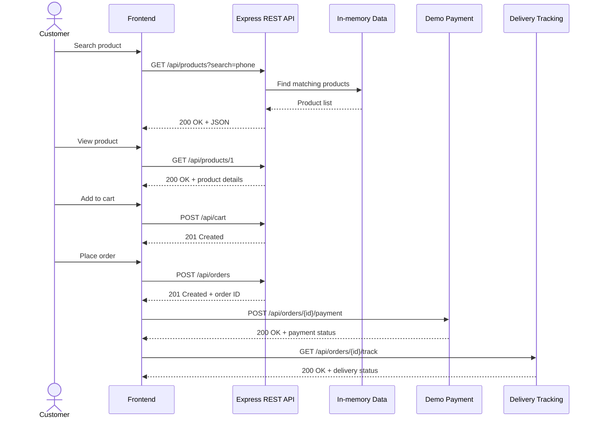

# ShopEase — Round 2 Low-Level Design Practical

## Run in VS Code
1. Open this folder in VS Code.
2. In Terminal, run `npm install`.
3. Run `npm start`.
4. Open http://localhost:3000.
5. Keep the terminal running.

## Task 1 & 2: REST API design (HTTP methods and URIs)

| Operation | Method | URI |
|---|---|---|
| Health check | GET | `/api/health` |
| Search products | GET | `/api/products?search=phone` |
| Get product details | GET | `/api/products/1` |
| Add to cart | POST | `/api/cart` |
| View cart | GET | `/api/cart?userId=101` |
| Place order | POST | `/api/orders` |
| Simulate payment | POST | `/api/orders/1001/payment` |
| Track order | GET | `/api/orders/1001/track` |
| Advance demo delivery status | PATCH | `/api/orders/1001/track` |

Use the actual order ID returned from `POST /api/orders`; `1001` is just an example.

## Task 3: Place Order request and response

Request:
- Method: `POST`
- URL: `http://localhost:3000/api/orders`
- Body → raw → JSON:
```json
{ "userId": 101 }
```

The cart must contain at least one item. Example success response (amount and ID depend on the cart):
```json
{
  "message": "Order created. Complete payment to confirm it.",
  "orderId": 1001,
  "totalAmount": 30000,
  "status": "PENDING_PAYMENT",
  "paymentStatus": "PENDING",
  "paymentEndpoint": "/api/orders/1001/payment"
}
```
HTTP status: `201 Created`.

## Task 4: HTTP status codes used
- `200 OK`: successful GET, successful simulated payment, successful tracking update.
- `201 Created`: item added to cart; order created.
- `400 Bad Request`: invalid quantity, empty cart, unsupported payment method, delivery advanced before payment.
- `404 Not Found`: product or order ID does not exist.

## Task 5: Sequence diagram



## Task 6: Track Order API

- Method: `GET`
- URL: `http://localhost:3000/api/orders/1001/track`
- Replace `1001` with the order ID generated by your own order.
- Example response:
```json
{
  "orderId": 1001,
  "status": "CONFIRMED",
  "paymentStatus": "PAID",
  "deliveryStatus": "PROCESSING"
}
```

For demo purposes, `PATCH /api/orders/{id}/track` advances the delivery through `PACKED`, `IN_TRANSIT`, and `DELIVERED`.

## Recommended Postman demonstration
1. `GET http://localhost:3000/api/products?search=phone`
2. `GET http://localhost:3000/api/products/1`
3. `POST http://localhost:3000/api/cart` with body `{ "userId": 101, "productId": 1, "quantity": 2 }`
4. `POST http://localhost:3000/api/orders` with body `{ "userId": 101 }`
5. Use the returned order ID in `POST http://localhost:3000/api/orders/1001/payment` with body `{ "method": "UPI" }`
6. `GET http://localhost:3000/api/orders/1001/track`
7. Repeat `PATCH http://localhost:3000/api/orders/1001/track` to demonstrate delivery progress.

## Important scope note
This is a student demo. The payment endpoint simulates success and does not charge money or connect to a payment gateway. Data is held in memory and resets when the server restarts. It is not production-ready.
